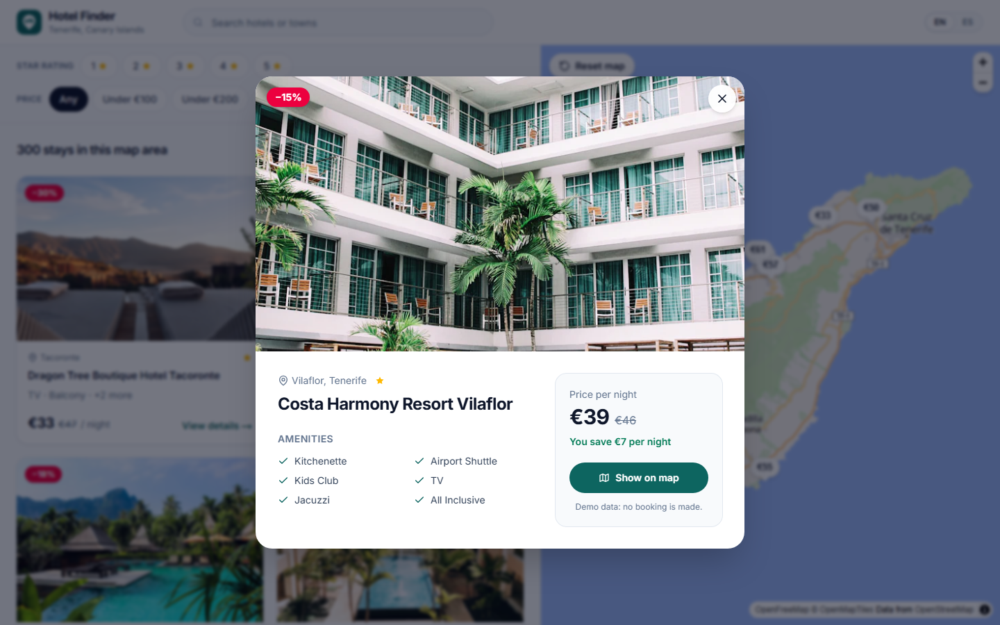
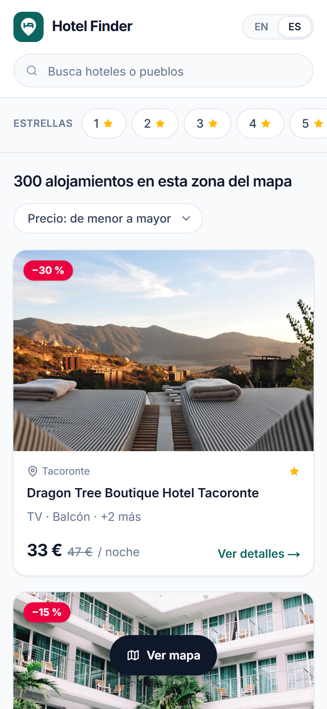
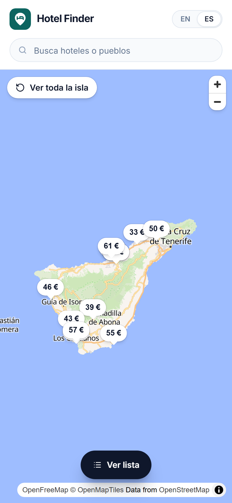

# Hotel Listings

[](https://github.com/Knightly95/hotel-listings/actions/workflows/deploy.yml)
[](#tests)

**[▶ Live demo](https://knightly95.github.io/hotel-listings/)**: no sign-up, API key or backend is needed.

> **Background:** I built this project in 2024 as a take-home for a frontend technical assessment in a hiring process. The commit history is the original one. I am now modernizing it step by step as a public refactoring exercise; see the [roadmap](#roadmap).

A hotel search page built with Next.js and TypeScript. Hotels are listed next to an interactive map, and the list follows the map: move or zoom the map and only the hotels in view are shown.

## Screenshot

[](docs/screenshots/search.png)

The list shows only the hotels inside the visible map area. Move or zoom the map and the list follows; hovering a card highlights its price on the map.

| Hotel details | Phone: list | Phone: map |
| --- | --- | --- |
| [](docs/screenshots/details.png) | [](docs/screenshots/phone-list.png) | [](docs/screenshots/phone-map.png) |

## Features

- **Map and list in sync:** the list shows the hotels inside the visible map area. Each listed hotel has a price marker; hovering a card highlights its marker, and clicking a marker opens a small card.
- **Search, filters and sorting:** search by hotel or town (accents don't matter), filter by star rating and maximum price, and sort by price, star rating or discount.
- **Hotel details:** a dialog with a large photo, every amenity, the saving per night and a "Show on map" button that flies the map to the hotel.
- **Clear states:** loading placeholders, an empty state with "Clear filters" and "Reset map", and an error state with "Try again".
- **Phones:** the list and the map take turns on small screens, with a button to switch.
- **Infinite scrolling:** more hotels load as you scroll the list.
- **Two languages:** English and Spanish, including prices (€120 or 120 €), with the visitor's browser language picked automatically.
- **Accessible:** real checkboxes, radio buttons and a native modal dialog under the styling, keyboard focus styles, and WCAG AA text contrast. Lighthouse accessibility is 100.
- **Own API:** `GET /api/hotels.json` serves 300 generated hotels around real towns in Tenerife.

## Tech stack

Next.js 14 (App Router) · TypeScript · Tailwind CSS 4 · Zustand · next-intl · MapLibre GL with OpenFreeMap tiles · Jest + React Testing Library · Playwright

Hotel photos are from [Unsplash](https://unsplash.com) ([credits](docs/photo-credits.md)) and are served with the site.

## Getting started

Prerequisite: Node.js 22 or newer.

```bash
npm install
npm run dev        # http://localhost:3000
```

| Script          | What it does                         |
| --------------- | ------------------------------------ |
| `npm run dev`   | Start the development server         |
| `npm run build` | Build for production                 |
| `npm start`     | Serve the production build           |
| `npm run lint`  | Run ESLint                           |
| `npm test`      | Run the tests with a coverage report |
| `npm run test:e2e` | Run the browser tests (build the static site first, see [Tests](#tests)) |

With Docker:

```bash
docker build -t hotel-listings .
docker run -p 3000:3000 hotel-listings
```

## How it works

- **Data:** [`src/data/hotels.ts`](src/data/hotels.ts) generates the hotels with a seeded random generator, so every build has the same data. The route handler in [`src/app/api/hotels.json/route.ts`](src/app/api/hotels.json/route.ts) serves it and is rendered at build time.
- **Map:** [MapLibre GL](https://maplibre.org/) renders OpenStreetMap data from [OpenFreeMap](https://openfreemap.org/). Neither needs an account or an access token.
- **State:** a Zustand store holds the hotels, the active filters, the sort order and the map bounds, and derives the visible page of hotels.
- **Languages:** next-intl with one statically generated page per language.

## Tests

- **Unit and component tests:** `npm test` runs 44 Jest and React Testing Library tests for the store, the data generator, the API client, the utilities, every component and the page. CI measures line coverage (98.6%) on every push to `main` and publishes the number shown in the badge above.
- **Browser tests:** 8 Playwright tests in [`e2e/`](e2e) run against the static build in a real Chromium: the list and its markers, infinite scrolling, filters, search, the details dialog with the keyboard, the language switch, a dark system theme, and the phone layout. To run them locally:

  ```bash
  STATIC_EXPORT=true npm run build
  npm run test:e2e
  ```

## Quality checks

A second CI job builds the app and checks what visitors get:

- **Browser tests:** the Playwright tests above.
- **Lighthouse** (mobile settings): the build fails if accessibility drops below 95 or best practices below 90; performance and SEO are reported. Last run (18 Nov 2026, after the redesign): performance 75, accessibility 100, best practices 100, SEO 100 on `/en/` and `/es/`. Before the redesign, performance was 60. The largest paint waits for the hotels, which are fetched in the browser; moving that to the server is roadmap step 4.
- **Bundle budget:** the JavaScript sent to the browser must stay under 465 kB gzip. Today it is 446.8 kB; before the redesign it was 442.8 kB. The redesign removed styled-components and added the dialog, search and map features. To check locally: `STATIC_EXPORT=true npm run build && node scripts/bundle-budget.mjs out 465`.

The Lighthouse report is attached to each CI run.

## Contributing

- [`CONTRIBUTING.md`](CONTRIBUTING.md): setup, checks, conventions and how to propose a change.
- [`AGENTS.md`](AGENTS.md): commands, rules and guardrails for AI coding agents.

## Deployment

Every push to `main` is linted, type-checked, tested, built as a static site and deployed to GitHub Pages by [`.github/workflows/deploy.yml`](.github/workflows/deploy.yml).

The static build is switched on with two environment variables:

```bash
STATIC_EXPORT=true NEXT_PUBLIC_BASE_PATH=/hotel-listings npm run build   # output in ./out
```

Without them, `npm run build` produces a normal Next.js server build.

## How AI was used

Since November 2026 I maintain this repo with an AI coding agent (Claude Code). The original assessment code is described in the background note at the top.

**What the agent did**

- Cleaned company and personal data out of the whole git history.
- Replaced Mapbox with MapLibre and free tiles (no token), added a small hotels API and a static export for GitHub Pages, and set up CI.
- Added `CONTRIBUTING.md`, `AGENTS.md`, templates, the coverage badge and the Lighthouse and bundle-size checks, and fixed the accessibility problems Lighthouse found.
- Redesigned the interface with Tailwind CSS (replacing styled-components), added search, the details dialog, price markers and the phone layout, and replaced the Cypress tests with Playwright tests that run in CI.

**How it is checked**

- The agent follows [AGENTS.md](AGENTS.md): commands, conventions and what it must not do.
- Every change goes through a pull request. I read the diff and merge it myself; nothing is pushed straight to `main`.
- CI runs lint, type-check and the 44 unit tests on every pull request, plus the 8 browser tests and the Lighthouse and bundle-size checks.

**Where it needed correcting**

Making the map markers accessible broke a test, because the test's stand-in for the map library had no `getElement` method. The stand-in was completed; the test was not weakened or removed.

## Roadmap

This repo is being modernized in small pull requests, each with its own before and after measurements:

1. ✅ Remove the dependency on third-party services and access tokens; add CI and a live demo.
2. Upgrade to the current Next.js and React versions.
3. ✅ Migrate styled-components to Tailwind CSS. Done together with a full redesign, because every component's look changed.
4. Move data fetching to TanStack Query and server components.
5. ✅ Replace the Cypress tests with Playwright and run them in CI.
6. Add German and Dutch.
