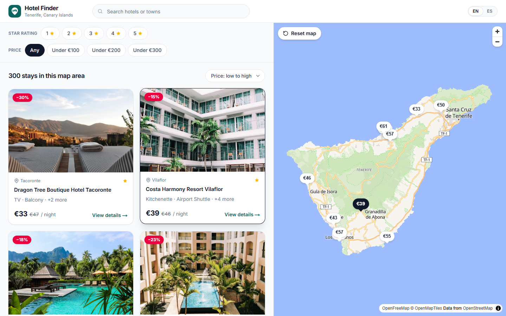

# Hotel Listings

[](https://github.com/Knightly95/hotel-listings/actions/workflows/deploy.yml)
[](#tests)

**[▶ Live demo](https://knightly95.github.io/hotel-listings/)**: no sign-up, API key or backend is needed.

> **Background:** I built this project in 2024 as a take-home for a frontend technical assessment in a hiring process. The commit history is the original one. I am now modernizing it step by step as a public refactoring exercise; see the [roadmap](#roadmap).

A hotel search page built with Next.js and TypeScript. Hotels are listed next to an interactive map, and the list follows the map: move or zoom the map and only the hotels in view are shown.

## Screenshot

[](docs/screenshots/search.png)

The list shows only the hotels inside the visible map area. Move or zoom the map and the list follows.

## Features

- **Map and list in sync:** the list shows the hotels inside the visible map area, and each hotel has a marker with a popup.
- **Filters and sorting:** filter by star rating and price range, sort by price.
- **Infinite scrolling:** more hotels load as you scroll the list.
- **Two languages:** English and Spanish, with the visitor's browser language picked automatically.
- **Own API:** `GET /api/hotels.json` serves 300 generated hotels around real towns in Tenerife.

## Tech stack

Next.js 14 (App Router) · TypeScript · Zustand · next-intl · MapLibre GL with OpenFreeMap tiles · styled-components · Jest + React Testing Library

## Getting started

Prerequisite: Node.js 22 or newer.

```bash
npm install
npm run dev        # http://localhost:3000
```

| Script          | What it does                         |
| --------------- | ------------------------------------ |
| `npm run dev`   | Start the development server         |
| `npm run build` | Build for production                 |
| `npm start`     | Serve the production build           |
| `npm run lint`  | Run ESLint                           |
| `npm test`      | Run the tests with a coverage report |

With Docker:

```bash
docker build -t hotel-listings .
docker run -p 3000:3000 hotel-listings
```

## How it works

- **Data:** [`src/data/hotels.ts`](src/data/hotels.ts) generates the hotels with a seeded random generator, so every build has the same data. The route handler in [`src/app/api/hotels.json/route.ts`](src/app/api/hotels.json/route.ts) serves it and is rendered at build time.
- **Map:** [MapLibre GL](https://maplibre.org/) renders OpenStreetMap data from [OpenFreeMap](https://openfreemap.org/). Neither needs an account or an access token.
- **State:** a Zustand store holds the hotels, the active filters, the sort order and the map bounds, and derives the visible page of hotels.
- **Languages:** next-intl with one statically generated page per language.

## Tests

`npm test` runs the Jest and React Testing Library tests for the store, the data generator, the API client, the utilities and the components. CI measures line coverage on every push to `main` and publishes the number shown in the badge above.

## Contributing

- [`CONTRIBUTING.md`](CONTRIBUTING.md): setup, checks, conventions and how to propose a change.
- [`AGENTS.md`](AGENTS.md): commands, rules and guardrails for AI coding agents.

## Deployment

Every push to `main` is linted, type-checked, tested, built as a static site and deployed to GitHub Pages by [`.github/workflows/deploy.yml`](.github/workflows/deploy.yml).

The static build is switched on with two environment variables:

```bash
STATIC_EXPORT=true NEXT_PUBLIC_BASE_PATH=/hotel-listings npm run build   # output in ./out
```

Without them, `npm run build` produces a normal Next.js server build.

## How AI was used

Since November 2026 I maintain this repo with an AI coding agent (Claude Code). The original assessment code is described in the background note at the top.

**What the agent did**

- Cleaned company and personal data out of the whole git history.
- Replaced Mapbox with MapLibre and free tiles (no token), added a small hotels API and a static export for GitHub Pages, and set up CI.
- Added `CONTRIBUTING.md`, `AGENTS.md`, templates, the coverage badge and the Lighthouse and bundle-size checks, and fixed the accessibility problems Lighthouse found.

**How it is checked**

- The agent follows [AGENTS.md](AGENTS.md): commands, conventions and what it must not do.
- Every change goes through a pull request. I read the diff and merge it myself; nothing is pushed straight to `main`.
- CI runs lint, type-check and the 21 tests on every pull request, plus the Lighthouse and bundle-size checks.

**Where it needed correcting**

Making the map markers accessible broke a test, because the test's stand-in for the map library had no `getElement` method. The stand-in was completed; the test was not weakened or removed.

## Roadmap

This repo is being modernized in small pull requests, each with its own before and after measurements:

1. ✅ Remove the dependency on third-party services and access tokens; add CI and a live demo.
2. Upgrade to the current Next.js and React versions.
3. Migrate styled-components to Tailwind CSS, one component per pull request.
4. Move data fetching to TanStack Query and server components.
5. Replace the Cypress tests with Playwright and run them in CI.
6. Add German and Dutch.

The Cypress end-to-end tests in [`cypress/`](cypress) are from the original version and are not part of CI yet (step 5).
